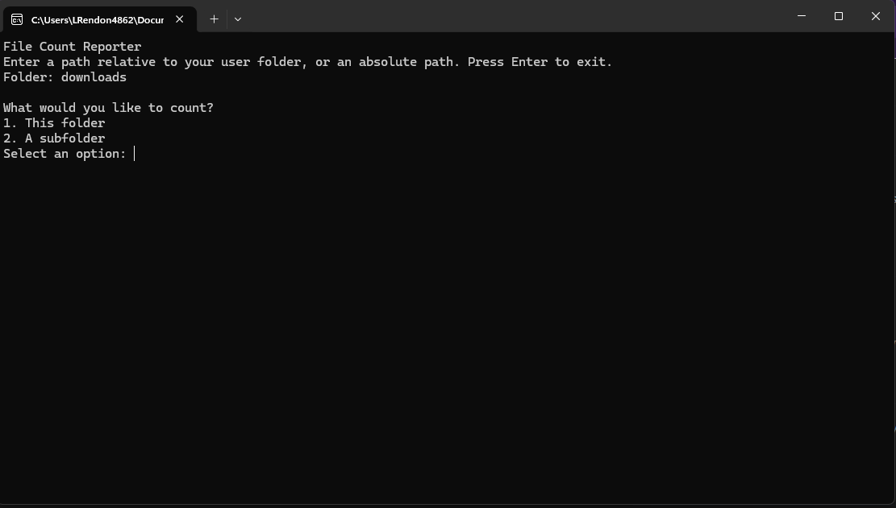
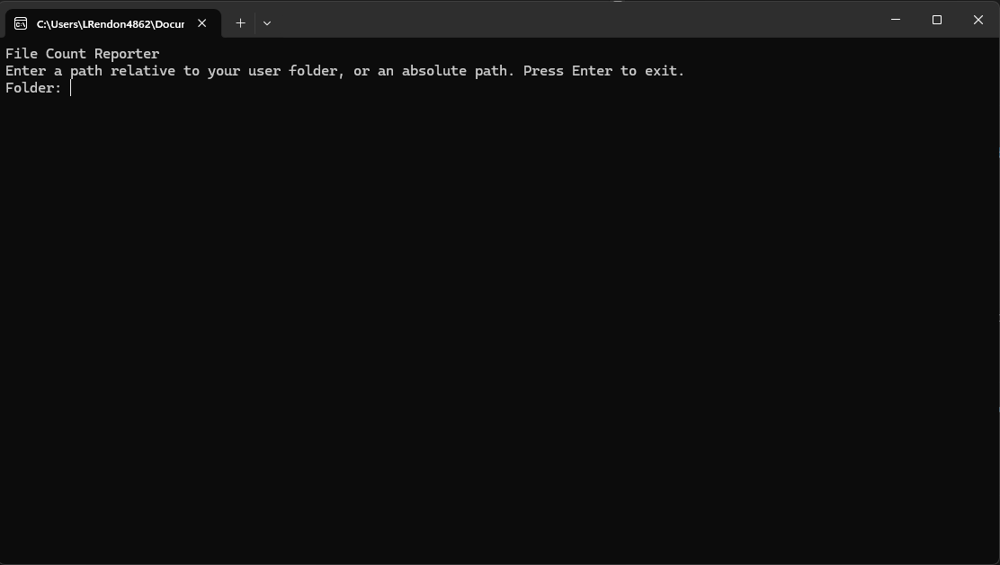
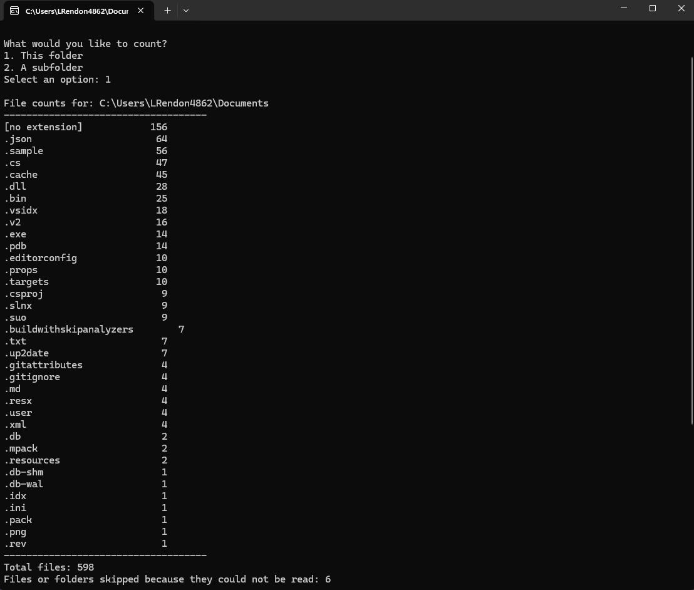
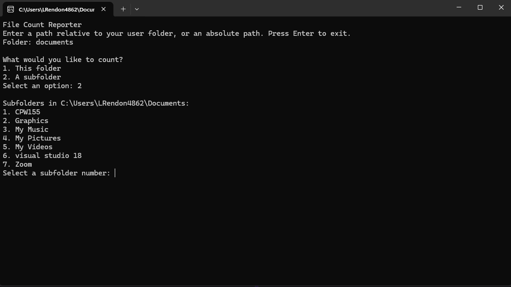
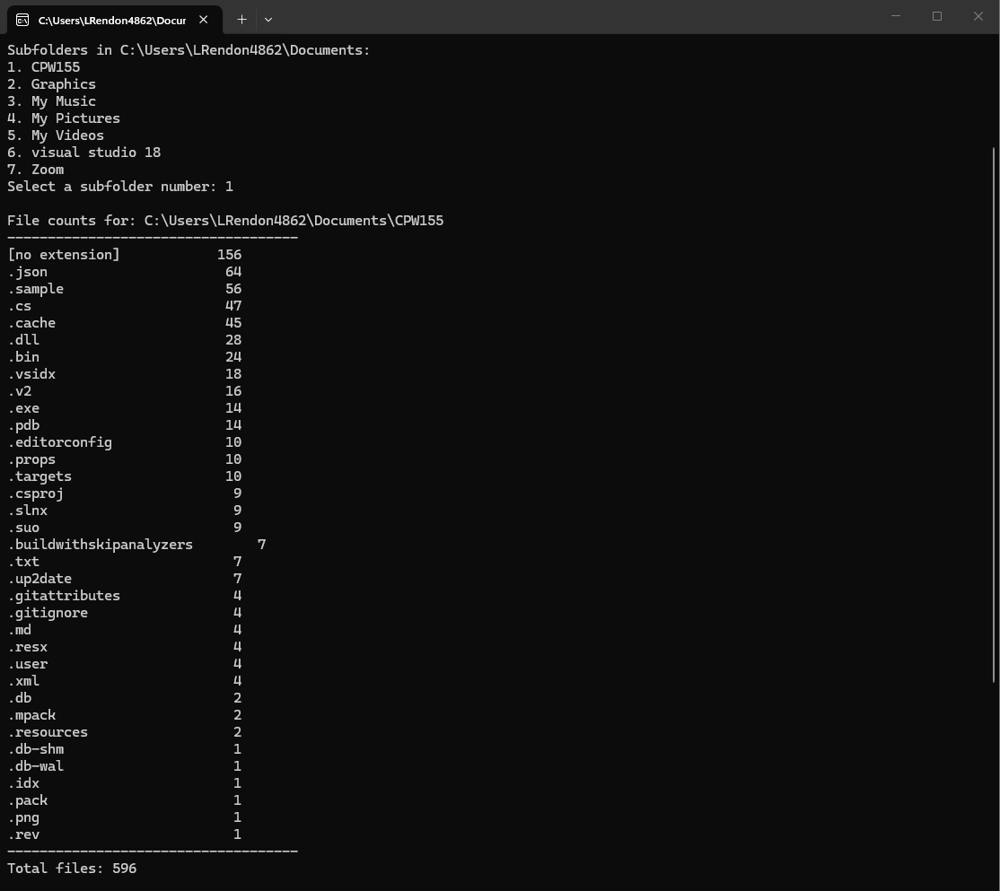

# FileCountReporter

## Description
A simple console app that counts the number of files in a specified folder and 
its subfolders, grouped by file type. 
The app allows users to select a folder, view the file counts, 
and navigate through subfolders.

## Disclaimer
This project was created with the help of GPT-5.6 Luna for education purposes.

## Prerequisites
- Windows 10 or later
- .NET 6.0 SDK or later
- A code editor or IDE (e.g., Visual Studio, Visual Studio Code)

## Downloads
https://visualstudio.microsoft.com/downloads/
https://dotnet.microsoft.com/en-us/download/dotnet/10.0

## Screenshots

